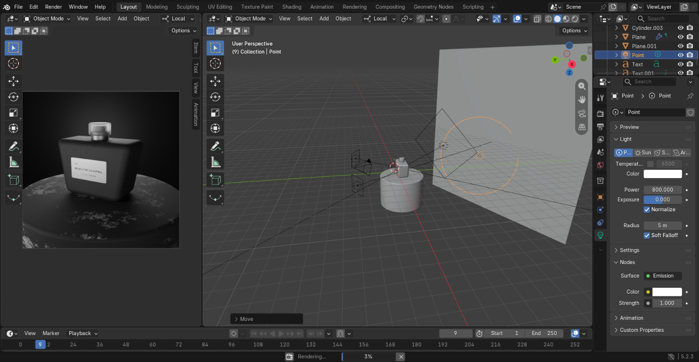
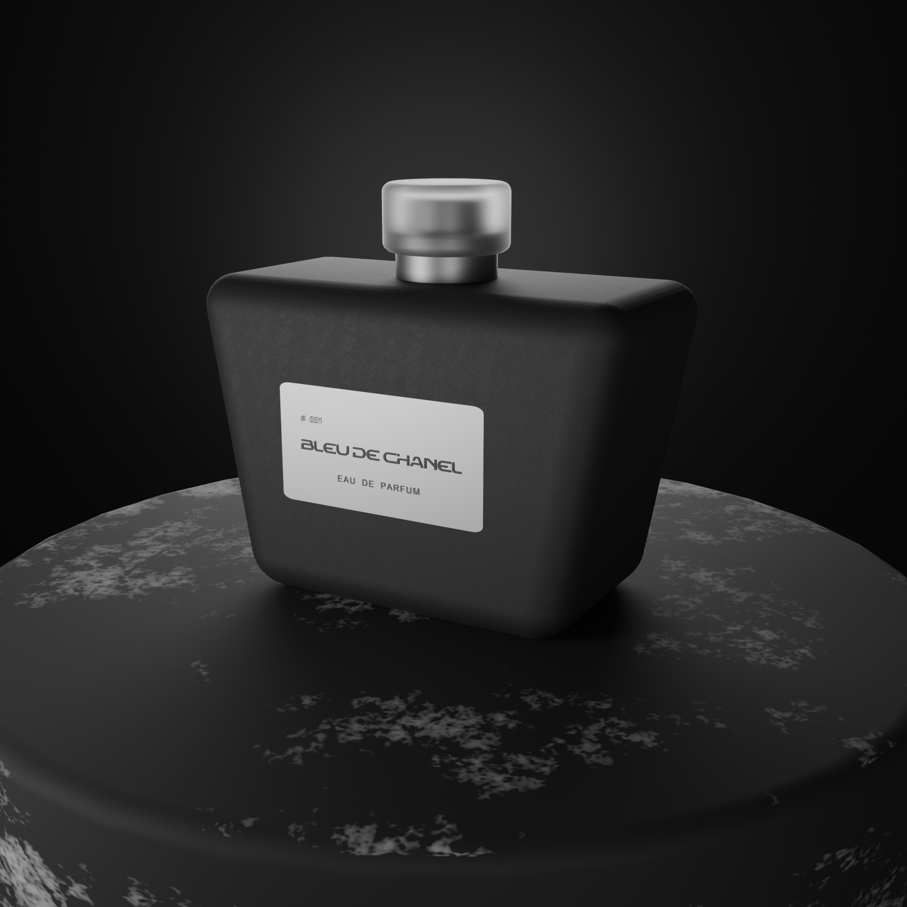
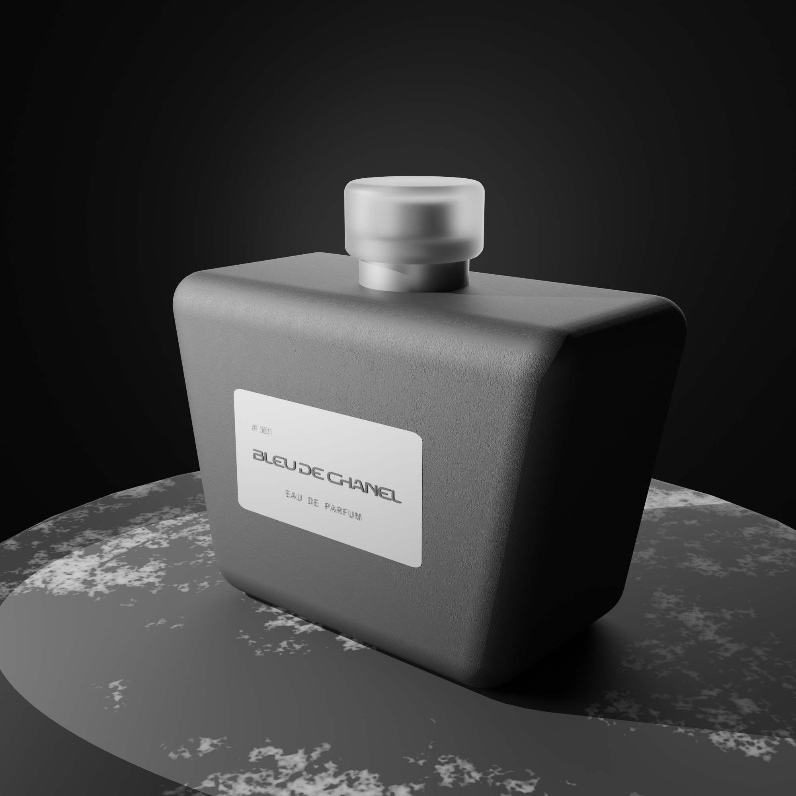

### 🗓️ Day 05 – Perfume Bottle Project 🧴

Today I created a small 3D project in Blender: a **Perfume Bottle**!

I modeled a perfume bottle, created a scene around it, experimented with lighting, and captured some beautiful camera shots.

**✨ What I Worked On**

- 🧴 **3D Modeling:** Created a perfume bottle using Blender.
- 🎨 **Materials:** Experimented with materials to give the bottle an attractive appearance.
- 💡 **Lighting:** Set up lighting to highlight the bottle and improve the overall look of the scene.
- 🌄 **Scene Setup:** Created a background and arranged the scene for a nice composition.
- 📷 **Camera Shots:** Positioned the camera and captured different shots of my perfume bottle.
- 🖼️ **Rendering:** Rendered the final scene and explored the results.

### 🖼️ Project Gallery

Here are some shots from my perfume bottle project.

  
  

**💭 My Experience**

This was a fun project! I enjoyed creating a perfume bottle and experimenting with lighting, scene setup, and camera angles.

It was exciting to see how different camera shots and lighting setups can change the overall appearance of a simple 3D object.

Just learning Blender for fun, exploring creativity, and enjoying every project! 🚀

